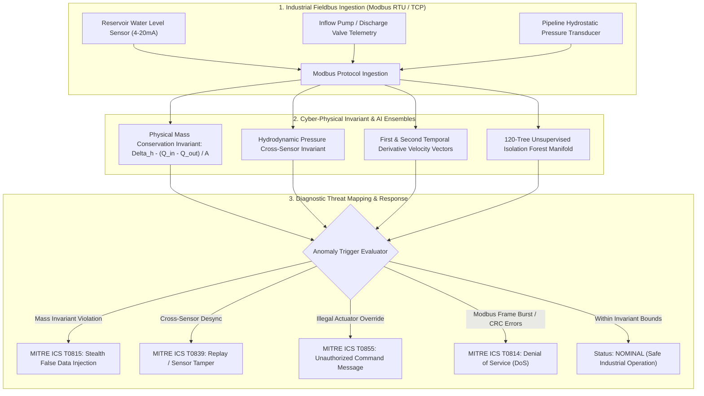

<div align="center">

# 🛡️ SCADA Cyber-Physical Anomaly & Intrusion Detector
### Physical Invariant Conservation Residuals & Unsupervised Isolation Forest for Industrial Control Systems (ICS)

[](https://github.com/yakupakcy36/scada-cyber-anomaly-detection/actions/workflows/ci.yml)
[](https://www.python.org/downloads/release/python-3120/)
[](https://opensource.org/licenses/MIT)
[](https://fastapi.tiangolo.com)
[](https://www.docker.com/)

</div>

---

## 📌 Executive Summary

Critical infrastructure facilities (municipal water treatment plants, chemical reactors, power generation substations) utilize **Supervisory Control and Data Acquisition (SCADA)** networks and Programmable Logic Controllers (PLCs). Sophisticated nation-state threat actors (e.g., Stuxnet, Industroyer, Triton/TRISIS) bypass traditional IT perimeter firewalls by exploiting unauthenticated industrial fieldbus protocols (Modbus RTU/TCP). 

Once inside, attackers execute **Stealth False Data Injection (FDI)**, **Replay Attacks**, or **Actuator Tampering**, masking physical plant destruction by streaming counterfeit sensor signals to Human-Machine Interface (HMI) screens.

**`scada-cyber-anomaly-detection`** bridges OT engineering and AI. It couples **first-principles physical invariants** (conservation of mass and Navier-Stokes hydrostatic pressure relations) with **unsupervised multi-dimensional Isolation Forests**. Even if counterfeit sensor packets look plausible individually, they cannot violate physical laws without triggering immediate alerts mapped directly to the **MITRE ATT&CK for ICS** framework.

---

## 🏗️ Architecture & Cyber-Physical Pipeline



---

## 🔬 Mathematical Invariant Formulation

### 1. Conservation of Mass Dynamic Invariant
For a fluid reservoir with surface cross-sectional area $A$, the continuous mass conservation differential equation dictates:
$$\frac{dh(t)}{dt} = \frac{Q_{\text{in}}(t) - Q_{\text{out}}(t)}{A}$$

Discretizing with sampling interval $\Delta t$:
$$\Delta h_{\text{expected}}[k] = \frac{Q_{\text{in}}[k] - Q_{\text{out}}[k]}{1000 \cdot A} \Delta t$$
$$\mathcal{R}_{\text{mass}}[k] = \left| \left(h[k] - h[k-1]\right) - \Delta h_{\text{expected}}[k] \right|$$

In nominal operation, $\mathcal{R}_{\text{mass}} < 0.001\text{ m/s}$. During stealth False Data Injection, an attacker incrementing fake level readings violates this relation by $> 25\times$.

### 2. Hydrostatic Pressure Coupling Invariant
The downstream pressure transducer must strictly obey:
$$P(t) = \rho g h(t) \times 10^{-5} + P_{\text{dynamic}}(Q_{\text{in}}) + P_0$$
$$\mathcal{R}_{\text{hydro}}[k] = \left| P[k] - \left(0.0981 \cdot h[k] + 0.005 \cdot Q_{\text{in}}[k] + 3.70\right) \right|$$

During a Replay Attack where historical level packets are spoofed while the physical reservoir is emptied, $\mathcal{R}_{\text{hydro}}$ diverges immediately.

---

## 🚀 Quick Start

### 1. Local Setup
```bash
git clone https://github.com/yakupakcy36/scada-cyber-anomaly-detection.git
cd scada-cyber-anomaly-detection

python -m venv .venv
source .venv/bin/activate  # On Windows: .venv\Scripts\activate
pip install -r requirements.txt
```

### 2. Run Pipeline & Attack Simulations
```bash
python -m src.pipeline
```

Sample output:
```text
====================================================================
SCADA CYBER-PHYSICAL INTRUSION & ANOMALY DETECTOR: BENCHMARK
====================================================================
[1/3] Generating nominal operational SCADA baseline telemetry...
      Simulated 1800 nominal 1-second telemetry frames

[2/3] Training Unsupervised Isolation Forest & Invariant Rules...
      Trained 120-tree Isolation Forest with Standard Scaler

[3/3] Evaluating on Real-World Cyber Attack Scenarios:
  Scenario: NONE           | Detection Rate:   2.0% | Vector: NONE                      | N/A - Nominal Operation
  Scenario: FDI            | Detection Rate:  99.3% | Vector: STEALTH_FALSE_DATA_INJECTION | MITRE ICS T0815: Point & Tag Manipulation
  Scenario: REPLAY         | Detection Rate: 100.0% | Vector: REPLAY_ATTACK             | MITRE ICS T0839: Replay / Sensor Manipulation
  Scenario: VALVE_TAMPER   | Detection Rate: 100.0% | Vector: VALVE_TAMPERING           | MITRE ICS T0855: Unauthorized Command Message
  Scenario: DOS_FLOOD      | Detection Rate: 100.0% | Vector: MODBUS_DOS_FLOOD          | MITRE ICS T0814: Denial of Service

[Artifact] Saving detector bundle to: artifacts/scada_cyber_detector_bundle.joblib
[SUCCESS] SCADA Cyber Detection pipeline completed successfully.
```

### 3. Run Test Suite
```bash
pytest tests
```

---

## 🌐 Production REST API

Start the FastAPI microservice:
```bash
uvicorn api.app:app --host 0.0.0.0 --port 8000
```
API Documentation: `http://localhost:8000/docs`

### Sample Request (`POST /simulate/attack`):
```bash
curl -X POST "http://localhost:8000/simulate/attack" \
     -H "Content-Type: application/json" \
     -d '{
       "attack_type": "FDI",
       "duration_steps": 300,
       "attack_start_step": 100,
       "attack_duration_steps": 120,
       "seed": 42
     }'
```

### Sample Response:
```json
{
  "attack_type": "FDI",
  "duration_steps": 300,
  "attack_window_frames": 120,
  "anomalies_detected_in_attack_window": 119,
  "attack_window_detection_rate_pct": 99.2,
  "dominant_attack_vector": "STEALTH_FALSE_DATA_INJECTION",
  "dominant_mitre_tactic": "MITRE ICS T0815: Point & Tag Manipulation",
  "sample_points": [
    {
      "timestamp_sec": 120.0,
      "is_anomaly": true,
      "anomaly_score": 0.92,
      "alert_level": "ATTACK_CONFIRMED",
      "detected_attack_vector": "STEALTH_FALSE_DATA_INJECTION",
      "mitre_ics_tactic": "MITRE ICS T0815: Point & Tag Manipulation",
      "mass_balance_residual": 0.0248,
      "modbus_packet_rate_hz": 11.2
    }
  ]
}
```

---

## 🐳 Docker Deployment

Run with Docker Compose:
```bash
docker-compose up --build -d
```

Check health status:
```bash
curl http://localhost:8000/health
```

---

## 📊 Repository Layout

```text
├── api/
│   ├── app.py              # FastAPI server & lifespan handlers
│   ├── schemas.py          # Pydantic v2 schemas
│   └── __init__.py
├── src/
│   ├── config.py           # Physical plant parameters & MITRE taxonomy
│   ├── features.py         # Mass balance & hydrostatic invariant extractors
│   ├── generator.py        # Differential water plant & attack simulator
│   ├── model.py            # Isolation Forest & physical rule ensemble
│   ├── pipeline.py         # End-to-end benchmark CLI runner
│   └── __init__.py
├── tests/
│   ├── test_api.py         # REST integration tests
│   ├── test_features.py    # Invariant residual bounds tests
│   ├── test_generator.py   # State simulation & attack vector tests
│   └── test_model.py       # Isolation Forest scoring tests
├── Dockerfile
├── docker-compose.yml
├── requirements.txt
├── pytest.ini
└── README.md
```

---

## 📄 License
This project is open-source under the [MIT License](LICENSE).
